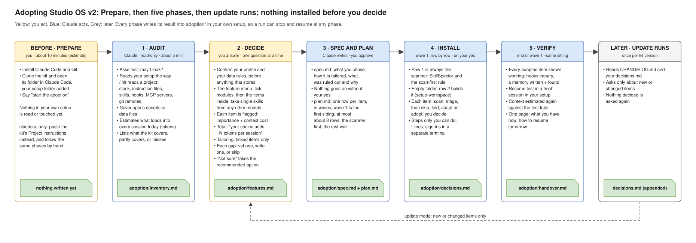

# Studio OS

How one solo studio works with Claude, written down so you can take the parts that fit your own work. Four habits carry it: work survives the night, plans come before code, a skill is trusted only after a security scan, and agents check each other's work.

It is not an installer. Your own Claude interviews you, proposes the smallest set that answers the problem you name, and puts each piece into your setup only on your yes. Nothing changes on its own, and "no" is a good answer.

## Who it is for

People who already use Claude for real work and keep losing time to the same things:

- every new day, or every new chat, starts from zero;
- long chats get slow and forgetful, and the choice of model is a guess;
- a skill from the internet might not be safe;
- Claude runs git with nothing to stop a mistake;
- numbers in a report that nobody can trace back to their query.

It covers software, data and machine-learning work; the adoption asks what you do and leaves out what does not fit. The whole kit needs Claude Code; with claude.ai alone, part of it carries over ([START-HERE.md](START-HERE.md), "If you only use claude.ai").

## How the adoption runs



After a short Prepare (installing Claude Code and Git, and getting the kit), the adoption has five phases. Each writes its result into an `adoption/` folder in your setup, so you can stop after any of them and pick up later.

1. **Audit:** on your yes, Claude looks at your setup, read-only, and never opens secrets or data files.
2. **Decide:** one question at a time: your work and your data rules first, then a menu of items, each with its importance for your kind of work and what it costs in context.
3. **Spec and plan:** what you chose, written down, and a plan whose first wave holds at most about 8 items.
4. **Install:** the first wave, item by item: scanned, decided, applied and checked.
5. **Verify:** every item shown working, and a new session that answers "where did we stop?" from your files, not from the chat.

Update runs later ask only about what a new kit version changed.

Deciding takes about an hour; installing the first wave comes after (estimates).

## Start

```bash
git clone https://github.com/Richicinschi/studio-os.git
```

Then follow [START-HERE.md](START-HERE.md): what to install first, where your setup lives, and the sentence that starts the adoption.

## What is inside

| Path | What it is |
|---|---|
| [START-HERE.md](START-HERE.md) | The page for you: setup, the first session, the words the kit uses. |
| [PRINCIPLES.md](PRINCIPLES.md) | Why the studio works this way, and what ignoring each principle cost. |
| [modules/](modules/) | Twelve practice areas, from continuity to experiments, each with its evidence. |
| [cards/](cards/) | One adoption page per item: how it is detected, asked, installed, checked and undone. |
| [catalog/](catalog/) | [The feature menu](catalog/FEATURES.md), and the skills and agents the kit ships. |
| [examples/](examples/) | Stories from the studio, with the names taken out. |
| [templates/](templates/) | Blank files to start from. |
| [ADOPT.md](ADOPT.md) | The protocol your Claude follows during the adoption. |

## Licence

MIT ([LICENSE](LICENSE)). The third-party skills in `catalog/skills/` keep their own licences, listed in [docs/THIRD_PARTY_NOTICES.md](docs/THIRD_PARTY_NOTICES.md).

Maintainers: [docs/MAINTAINING.md](docs/MAINTAINING.md).
