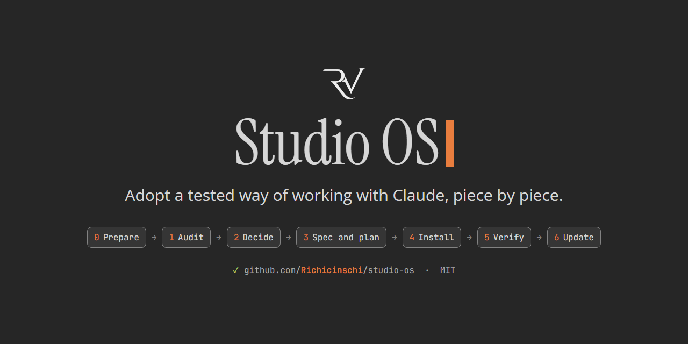

<p align="center">
  
</p>

<p align="center">
  <a href="START-HERE.md"><b>Start here</b></a>
  &nbsp;·&nbsp; <a href="PRINCIPLES.md">Principles</a>
  &nbsp;·&nbsp; <a href="catalog/FEATURES.md">Feature menu</a>
  &nbsp;·&nbsp; <a href="modules/">Modules</a>
</p>

<p align="center">
  <a href="https://github.com/Richicinschi/studio-os/actions/workflows/test.yml"></a>
</p>

<br>

**Studio OS** is an adoption kit for Claude Code: how one solo studio works with Claude, written down so you can take the parts that fit your own work.

It is not an installer. Your own Claude interviews you, proposes the smallest set that answers the problem you name, and changes your setup only on your yes.

## Why

- **Work survives the night.** Memory, handoff notes and one front-door file, so a new session starts where the last one stopped.
- **Plans come before code.** A spec, a plan, then the work, and a check before anything is called done.
- **Nothing runs unscanned.** Every outside skill, plugin or hook gets a security scan before it is installed.
- **Agents check each other.** Reviewers, and a council for the decisions that matter.

## Who it is for

People who use Claude for real work and keep losing time to the same things:

- every new day, or new chat, starts from zero;
- long chats get slow and forgetful, and the model choice is a guess;
- a skill from the internet might not be safe;
- Claude runs git with nothing to stop a mistake.

It fits software, data and machine-learning work, and leaves out what does not fit yours. The full kit needs Claude Code; part of it carries over to claude.ai.

## How it works

| Phase | What happens |
|---|---|
| **Audit** | On your yes, Claude looks at your setup, read-only. It never opens secrets or data files. |
| **Decide** | A few questions, then a menu: each item with its value for your work and its cost in context. |
| **Spec and plan** | What you chose, written down, with a first wave of at most about 8 items. |
| **Install** | The first wave, item by item: scanned, applied, checked. |
| **Verify** | Proof: a fresh session answers "where did we stop?" from your files. |

Every phase writes to an `adoption/` folder in your setup, so you can stop and pick up any time. Later updates ask only about what changed. The full picture: [docs/adoption-sequence.svg](docs/adoption-sequence.svg).

## Quick start

```bash
cd "$HOME"
git clone https://github.com/Richicinschi/studio-os.git
mkdir "$HOME/claude-setup"
cd "$HOME/studio-os"
claude --add-dir "$HOME/claude-setup"
```

These lines work in bash, zsh and PowerShell, not in Windows' `cmd.exe`.

Then say **"Start the adoption."** Installing Claude Code and git, and where your setup can live: [START-HERE.md](START-HERE.md).

## What is inside

| Where | What |
|---|---|
| [START-HERE.md](START-HERE.md) | Setup, the first session, and the words the kit uses |
| [PRINCIPLES.md](PRINCIPLES.md) | Why the studio works this way, and what ignoring each principle cost |
| [modules/](modules/) | Twelve practice areas, from continuity to experiments |
| [cards/](cards/) | One page per item: how it is detected, asked, installed, checked and undone |
| [catalog/](catalog/) | The [feature menu](catalog/FEATURES.md), and the skills and agents the kit ships |
| [examples/](examples/) | Stories from the studio, with the names taken out |
| [templates/](templates/) | Blank files to start from |
| [ADOPT.md](ADOPT.md) | The protocol your Claude follows during the adoption |
| [docs/trials.md](docs/trials.md) | How the adoption was tested, by invented personas rather than real adopters, and what that does not prove |
| [CHANGELOG.md](CHANGELOG.md) | What each release added, changed and removed |

## Problems and changes

A bug or a step that confused you: open an issue ([CONTRIBUTING.md](CONTRIBUTING.md)). A security problem: report it privately ([SECURITY.md](SECURITY.md)).

## Licence

MIT, see [LICENSE](LICENSE). The third-party skills in `catalog/skills/`, and the parts of a domain that its credit file names, keep their own licences ([notices](docs/THIRD_PARTY_NOTICES.md)). Maintainers: [docs/MAINTAINING.md](docs/MAINTAINING.md).
