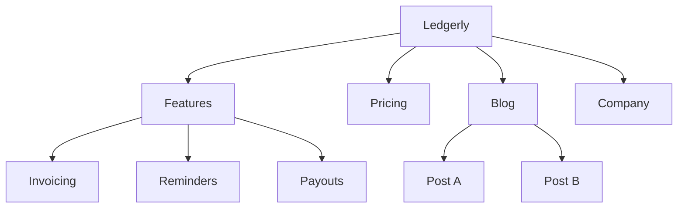
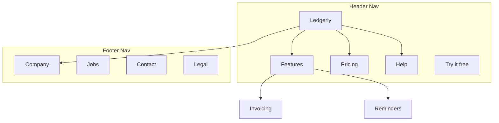

# Site Architecture

You decide which pages a site has, how they nest, how people move between them and what each address looks like. Two readers matter: the visitor looking for something, and the crawler following links.

Not this skill: XML sitemap files and crawl or indexing audits belong to seo-audit. Structured data belongs to schema.

The examples below use an imaginary invoicing app called "Ledgerly" and a few other made-up sites. Swap in the real names.

## Before you plan

If a product marketing context file exists (`.agents/product-marketing.md`, `.claude/product-marketing.md`, or the older `product-marketing-context.md`), read it first, use it, and ask only for what it does not cover or what is specific to this task. Otherwise ask for these four things:

1. **Business.** What the company sells, who the audiences are, and the three goals the site serves (conversions, SEO traffic, education, support).
2. **State.** New build or restructure? If a restructure, what hurts today (bounces, rankings, people lost)? Which existing URLs must keep working?
3. **Type.** SaaS marketing, content or blog, e-commerce, documentation, hybrid, or small and local business.
4. **Inventory.** How many pages exist or are planned, which ones earn the most (traffic, revenue, strategic value), and what sections are coming.

## Starting points by site type

| Type | Usual depth | Core sections | URL shape |
|---|---|---|---|
| SaaS marketing | 2-3 | Home, Features, Pricing, Blog, Docs | `/features/invoicing`, `/blog/cash-flow-basics` |
| Content or blog | 2-3 | Home, Blog, Categories, About | `/blog/slow-composting`, `/category/soil` |
| E-commerce | 3-4 | Home, Categories, Products, Cart | `/category/subcategory/product`, e.g. `/espresso/grinders/burr-30` |
| Documentation | 3-4 | Home, Guides, API reference | `/docs/section/page`, e.g. `/docs/cli/init` |
| SaaS plus content | 3-4 | Home, Product, Blog, Resources, Docs | `/product/booking`, `/blog/no-show-rates` |
| Small or local business | 1-2 | Home, Services, About, Contact | `/services/wheel-truing` |

Full trees for each type: [templates by site type](site-architecture/references/site-type-templates.md).

## Hierarchy

### Depth

A common rule of thumb: every important page within three clicks of the homepage. It is a studio guideline, not a measured limit, but a key page sitting four levels down suggests the structure is wrong.

| Shape | Suits | Cost |
|---|---|---|
| Flat, 2 levels | Portfolios, tiny sites | Easy, but it stops scaling quickly |
| Medium, 3 levels | Most marketing and content sites | Balanced |
| Deep, 4+ levels | Shops, big documentation | Handles volume, may hide pages |

Stay as flat as the navigation can stay tidy. When one dropdown grows past a screenful of entries (roughly 20, as a rule of thumb), insert a grouping level.

### Levels

| Level | Meaning | Example |
|---|---|---|
| L0 | Homepage | `/` |
| L1 | Main sections | `/features`, `/blog`, `/pricing` |
| L2 | Pages inside a section | `/features/reminders`, `/blog/late-payers` |
| L3+ | Detail pages | `/docs/webhooks/signing` |

### Drafting the tree

Draft with a text tree, one line per page, URL in brackets:

```
Ledgerly (/)
├── Features (/features)
│   ├── Invoicing (/features/invoicing)
│   ├── Reminders (/features/reminders)
│   └── Payouts (/features/payouts)
├── Pricing (/pricing)
├── Blog (/blog)
│   ├── [Category: Tax] (/blog/category/tax)
│   └── [Category: Cash flow] (/blog/category/cash-flow)
├── Customers (/customers)
│   ├── Studio stories (/customers/studios)
│   └── Freelancer stories (/customers/freelancers)
├── Help (/help)
│   ├── First invoice (/help/first-invoice)
│   └── Webhooks (/help/webhooks)
├── Company (/company)
│   └── Jobs (/company/jobs)
└── Contact (/contact)
```

Pick text for quick drafts, chat, and small structures. Pick Mermaid when the result will be shown to someone, when pages cross-link in a tangle, or when you want to mark which nav area owns which page.

## Navigation

| Kind | Job | Where |
|---|---|---|
| Header | Main routes, always on screen | Top of each page |
| Dropdown | Groups children under a parent | Opens from a header item |
| Footer | Secondary links, legal, sitemap | Bottom of each page |
| Sidebar | Moves within one section (docs, blog) | Left of the content |
| Breadcrumbs | Shows where you are | Under the header |
| In-content links | Related reading, next step | Inside the page body |

### Header rules

Read the bar left to right: logo (links home), then the links, then the call-to-action button ("Try it free", "Book a demo") at the far right. Order the links by importance or traffic, busiest first. As a studio default, keep to four to seven top-level links so the bar stays easy to scan, and start any mega menu at three or four columns.

### Footer

Sort links into labelled columns:
- Product: Features, Pricing, Integrations, Release notes
- Learn: Blog, Customer stories, Templates, Help
- Company: About, Jobs, Contact, Press kit
- Legal: Privacy, Terms, Security

### Breadcrumbs

```
Home > Features > Reminders
Home > Blog > Tax > Quarterly Filing Checklist
```

The trail must mirror the URL path. Every step is a clickable link except the current page.

| URL | Trail |
|---|---|
| `/features/payouts` | Home > Features > Payouts |
| `/blog/late-payers` | Home > Blog > Late Payers |
| `/help/webhooks/signing` | Home > Help > Webhooks > Signing |

More patterns (mega menus, footers, sidebars, mobile, anti-patterns): [navigation patterns](site-architecture/references/navigation-patterns.md).

## URLs

### URL principles

1. A person can read it: `/features/payouts`, never `/p/9x2`.
2. Hyphens between words, no underscores.
3. The path follows the hierarchy.
4. Choose trailing slash or none, then enforce that choice everywhere.
5. All lowercase. `/Pricing` must redirect to `/pricing`.
6. Brief but meaningful. `/blog/chasing-late-invoices` beats `/blog/how-to-politely-chase-customers-who-pay-their-invoices-late`.

### URL patterns by page type

| Page | Pattern | Example |
|---|---|---|
| Home | `/` | `ledgerly.example` |
| Feature | `/features/{name}` | `/features/invoicing` |
| Pricing | `/pricing` | `/pricing` |
| Blog post | `/blog/{slug}` | `/blog/cash-flow-basics` |
| Blog category | `/blog/category/{slug}` | `/blog/category/tax` |
| Case study | `/customers/{slug}` | `/customers/north-pier-studio` |
| Docs | `/docs/{section}/{page}` | `/docs/webhooks/signing` |
| Legal | `/{page}` | `/privacy`, `/terms` |
| Landing page | `/{slug}` or `/lp/{slug}` | `/early-access`, `/lp/spring-promo` |
| Comparison | `/compare/{rival}` or `/vs/{rival}` | `/compare/rival-one` |
| Integration | `/integrations/{name}` | `/integrations/stripe` |
| Template | `/templates/{slug}` | `/templates/freelance-contract` |

### URL mistakes

- **Dates in blog paths.** `/blog/2031/06/02/new-feature` lengthens the address for nothing; use `/blog/new-feature`.
- **Too many levels.** `/store/range/line/model/variant` is too deep; flatten where possible.
- **Moving a URL with no redirect.** Each old address needs a 301 to its new one. Skip it and you throw away inbound link value and break every bookmark and external link.
- **Numeric IDs.** `/invoice-guide/884` says nothing; use a slug.
- **Content chosen by query string.** `/blog?post=57` should be `/blog/new-feature`.
- **Mixed parents.** Do not have `/features/invoicing` next to `/product/payouts`; choose one parent.

## Mermaid sitemaps

Use `graph TD` for sitemaps. It shows parent-child links clearly and can group pages by nav area.



Subgraphs mark navigation zones:



More diagrams: [Mermaid sketches](site-architecture/references/mermaid-templates.md).

## Internal linking

| Type | Job | Example |
|---|---|---|
| Navigational | Move between sections | Header, footer, sidebar |
| Contextual | Point to related material in the text | "see how reminders work", linked to the reminders page |
| Hub and spoke | Tie cluster pages to a main page | Posts that link to a pillar guide |
| Cross-section | Join related pages in different sections | A feature page that links to a customer story |

### Linking rules

1. No orphan pages. Every page has at least one internal link pointing in.
2. Anchor text says where the link goes ("our reminder settings"), never "click here".
3. A starting density is 5 to 10 internal links per 1,000 words; it is a rule of thumb, not a measured target.
4. Give the pages that matter most (home, main features, pricing) the most inbound links.
5. Use breadcrumbs: they give every page free internal links.
6. End posts and pages with a related-content block.

### Hub and spoke

On content-heavy sites, build around a hub page:

```
Hub: /blog/cash-flow-guide (long overview)
├── Spoke: /blog/payment-terms (links back to hub)
├── Spoke: /blog/late-fees (links back to hub)
├── Spoke: /blog/invoice-timing (links back to hub)
└── Spoke: /blog/forecasting (links back to hub)
```

The hub lists every spoke, each spoke links back to the hub, and spokes link to one another when the topics touch.

### Link audit

- [ ] Each page has an inbound internal link
- [ ] No internal link returns 404
- [ ] Anchor text is descriptive of the target page (Google Search Central's link best practices page discourages "click here" style text)
- [ ] The most important pages collect the most inbound links
- [ ] Breadcrumbs appear on every page
- [ ] Blog posts carry related-content links
- [ ] Features connect to customer stories, and the blog connects to product pages

## Deliverables

A plan is not finished until it contains all five parts.

1. **Page hierarchy.** The whole tree as text, URL on every node.
2. **Mermaid sitemap.** Page relationships, with nav-zone subgraphs where they help.
3. **URL map.** One row per page:

| Page | URL | Parent | Nav location | Priority |
|---|---|---|---|---|
| Home | `/` | none | Header | High |
| Features | `/features` | Home | Header | High |
| Reminders | `/features/reminders` | Features | Header dropdown | Medium |
| Pricing | `/pricing` | Home | Header | High |
| Help | `/help` | Home | Header | Medium |

4. **Navigation spec.** Ordered header items with the CTA, footer sections and links, sidebar if any, and how breadcrumbs are built.
5. **Linking plan.** Hubs and their spokes, cross-section links worth adding, an orphan check when restructuring, and the links each key page should carry.

## Questions to ask

1. New site, or restructuring one that exists?
2. Which kind of site is it (software, publishing, shop, documentation, a mix, a local firm)?
3. What is the current or expected page count?
4. Which five pages matter most?
5. Which current URLs must stay or be redirected?
6. Who are the audiences and what are they trying to get done?

## Related skills

- **content-strategy**: what to write, and topic clusters
- **programmatic-seo**: SEO pages generated at scale from templates and data
- **seo-audit**: technical SEO, on-page work, indexing problems
- **cro**: conversion work on single pages
- **schema**: breadcrumb and navigation structured data
- **competitors**: comparison page formats and their URLs
