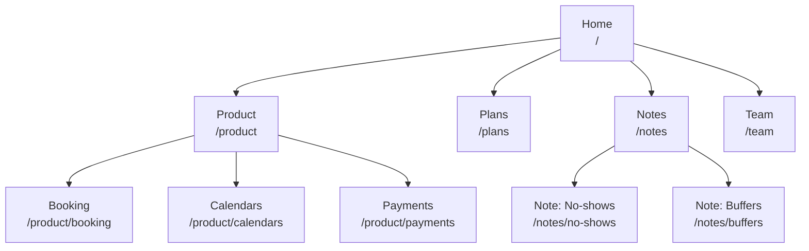
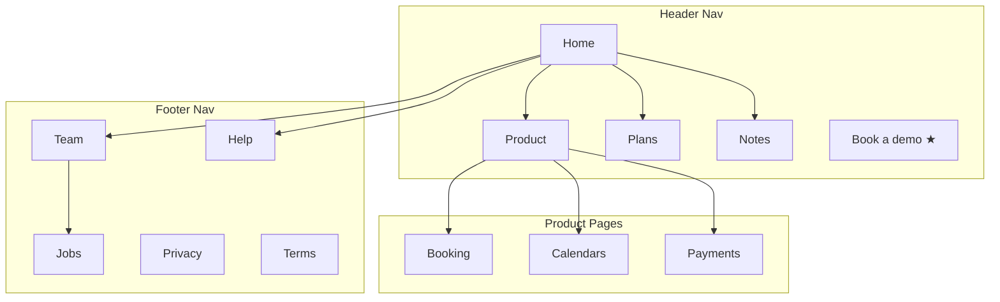
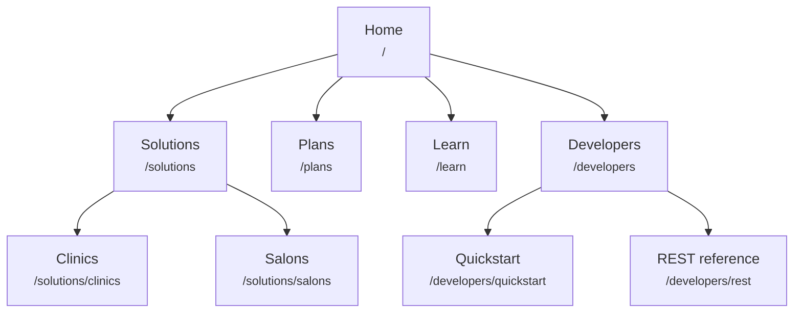
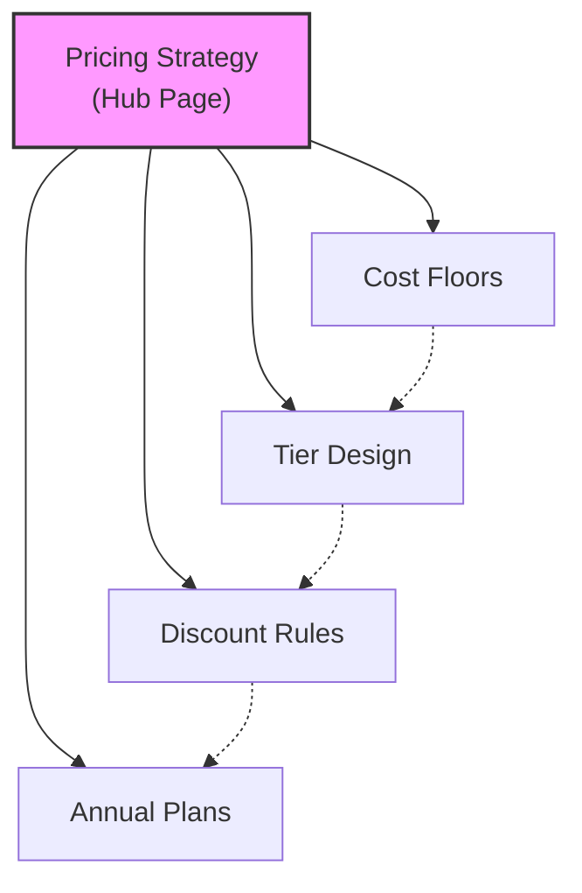
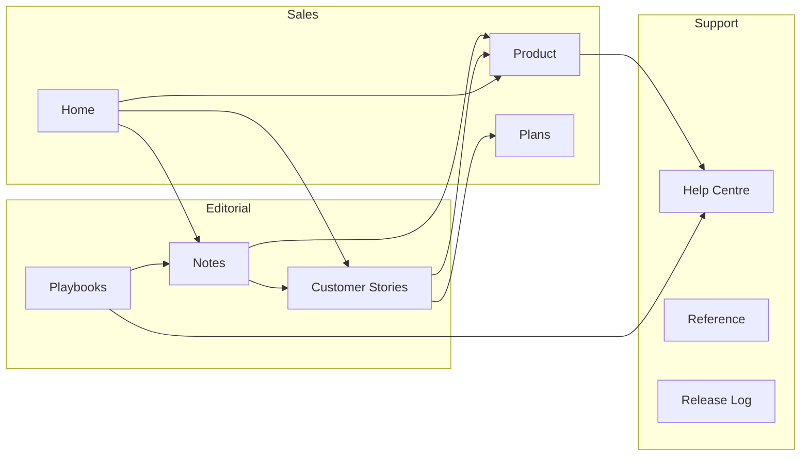
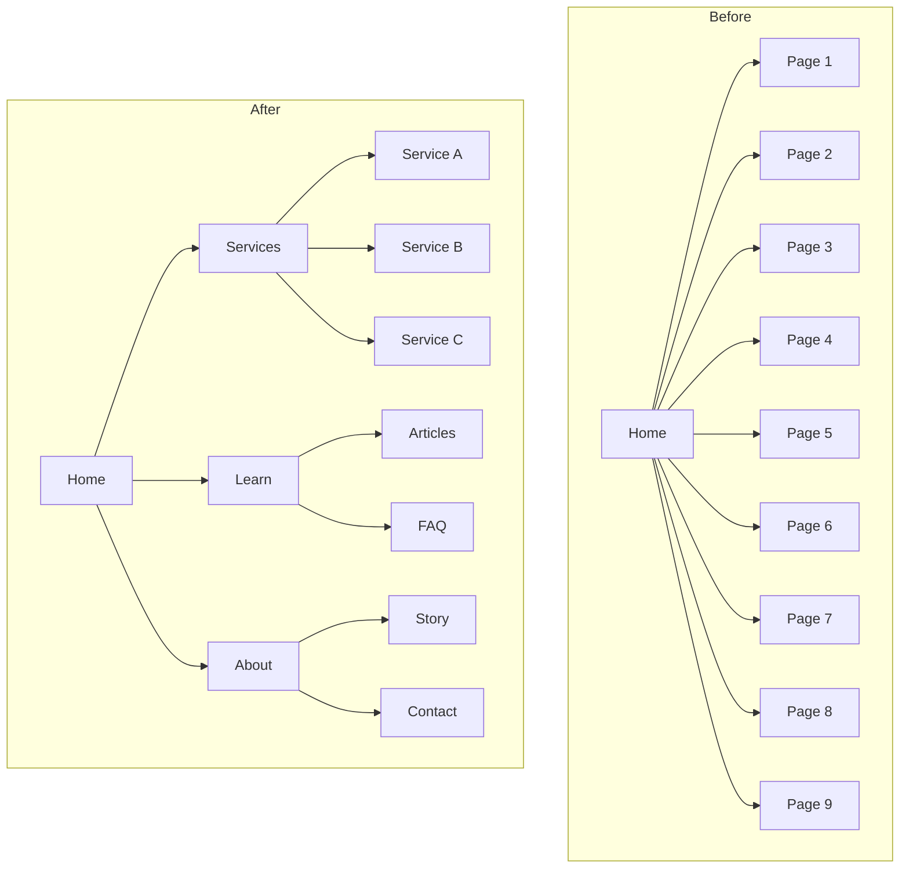
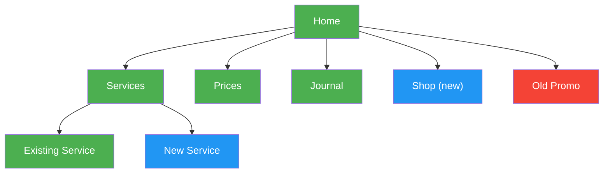

# Mermaid Diagram Templates

Ready-to-paste Mermaid sketches for sitemaps. Swap in your own labels and edges. The sample site is an imaginary scheduling app.

---

## Names and URLs

A top-down tree; each node carries a page name and its path.

---

## Navigation zones

Each subgraph is one area of the interface, so you can see where a page is linked from.

---

## URL labels

Same idea with the path in small type under the name.

---

## Hub and spoke

One central guide with its supporting articles. The dotted arrows are links between neighbouring spokes.

Reading it: a solid line joins the hub to a spoke; a dashed line joins two spokes.

---

## Linking flow

Which sections send readers to which. Left-to-right layout.

---

## Before and after

Put the current structure beside the proposed one to show what a restructure changes.

---

## Colour coding

Fill colours can show the status of each page in a restructure.

Key:
- Green `#4CAF50`: page stays as is
- Blue `#2196F3`: page to be written
- Red `#f44336`: page to delete or redirect
- Yellow `#FFC107`: page to move or rework
- Purple `#9C27B0`: top-priority or call-to-action page
