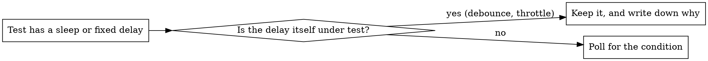

# Waiting on a condition, not on the clock

## Why

A test that sleeps for a fixed time is betting on speed. The bet wins on your laptop and loses on a busy CI runner. The result is a test that passes most days and fails on the others.

Rule: wait for the thing you actually need to be true. Never wait for a number of milliseconds that you hope is enough.

## Should this test use it?



Reach for it when:
- the test sleeps (`setTimeout`, `sleep`, `time.sleep()`) to let async work finish
- the test passes alone and fails under load
- the test times out only when suites run in parallel

Leave the sleep in when the timing is the behaviour being checked, such as a debounce window or a throttle interval. Explain the number in a comment.

## The swap

```typescript
// Before: a guess
await new Promise(r => setTimeout(r, 120));
expect(cache.get('user:7')).toBeDefined();

// After: the real condition
await waitFor(() => cache.get('user:7'), 'user:7 to be cached');
expect(cache.get('user:7')).toBeDefined();
```

## Common conditions

| What you wait for | Condition |
|-------------------|-----------|
| A message arrives | `waitFor(() => inbox.find(m => m.kind === 'READY'), 'READY message')` |
| A status flips | `waitFor(() => job.status === 'finished', 'job to finish')` |
| A quota is reached | `waitFor(() => rows.length >= 8, '8 rows')` |
| A file shows up | `waitFor(() => fs.existsSync(outPath), 'output file')` |
| Two things at once | `waitFor(() => conn.open && conn.peers > 2, 'open connection with peers')` |

## A minimal helper

```typescript
async function waitFor<T>(
  check: () => T | undefined | null | false,
  what: string,
  limitMs = 5000
): Promise<T> {
  const deadline = Date.now() + limitMs;
  for (;;) {
    const value = check();
    if (value) return value;
    if (Date.now() > deadline) {
      throw new Error(`Gave up waiting for ${what} after ${limitMs}ms`);
    }
    await new Promise(r => setTimeout(r, 10));
  }
}
```

`condition-based-waiting-example.ts` next to this file has a fuller set, with helpers for event streams.

## Mistakes to avoid

- Polling every 1 ms burns CPU for nothing. Poll about every 10 ms.
- A loop with no deadline hangs forever when the condition never comes true. Always set a limit and make the error say what was awaited.
- Reading the state once before the loop gives you a stale value. Call the getter inside the loop, every pass.

## When a fixed delay is right

Sometimes you must wait a known amount of time after a condition holds.

```typescript
// The worker flushes its buffer every 250 ms. We need one full flush
// to see the partial batch, so wait for the start, then one interval.
await waitFor(() => worker.state === 'running', 'worker to start');
await new Promise(r => setTimeout(r, 250));
```

Three conditions apply:
1. Wait for the triggering condition first.
2. The delay comes from a timing you know, not one you guessed.
3. A comment says why.

## What it fixed once

In one suite, swapping guessed delays for condition waits took 15 intermittently failing tests across 3 files from about 60% passing to 100%, and the run finished roughly 40% sooner.
