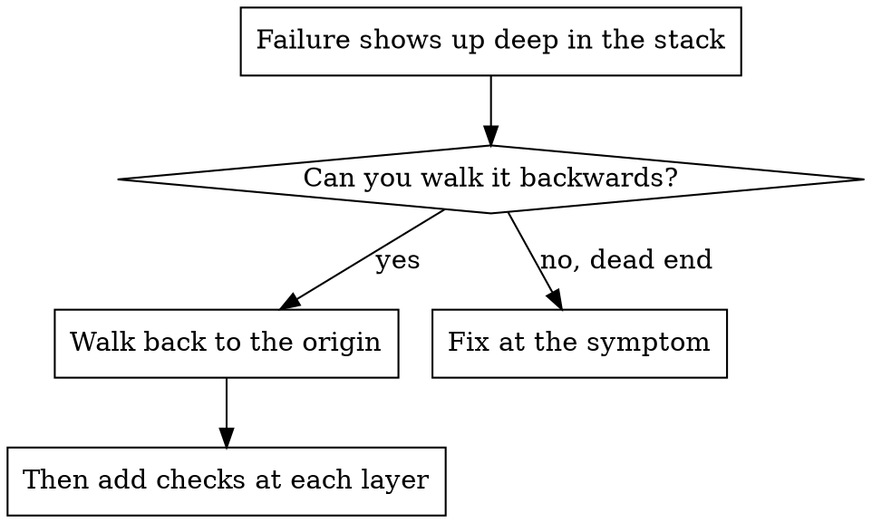
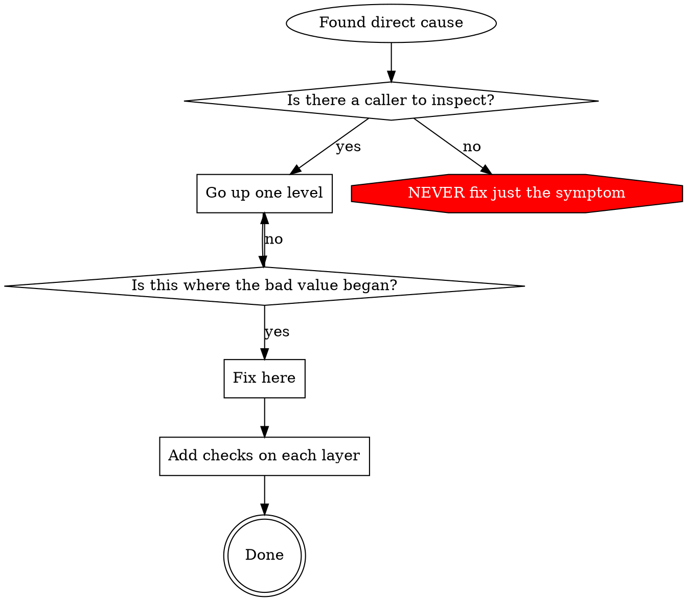

# Tracing a failure back to its cause

## The problem

Failures often surface far from where they began: a file appears in the wrong folder, a database opens at the wrong path, a command runs in the wrong directory. The natural move is to patch the spot where it blew up. That patch treats a symptom.

Rule: walk backwards up the call chain until you reach where the bad value was first produced, and fix it there.

## When it applies



Use it when:
- the error happens well inside execution, not at the entry point
- the stack trace is long
- you cannot tell where the bad value came from
- you need to learn which test or caller sets it off

## Steps

### 1. Write down the symptom
```
Stray file after the suite: services/api/manifest.json (not in git, not created by hand)
```

### 2. Find the line that directly causes it
```typescript
await execFileAsync('tar', ['-xf', archive], { cwd: unpackDir });
```

### 3. Ask who called it
```typescript
Importer.unpack(archive, unpackDir)
  -> called by Importer.open()
  -> called by Importer.openLatest()
  -> called by the integration test, inside makeImporter()
```

### 4. Keep climbing and inspect each value
- `unpackDir` was `''`
- `execFile` ignores an empty `cwd`, so the child process started in the current directory
- the current directory was `services/api/`

### 5. Locate the first bad value
```typescript
const env = makeTestEnv(); // returns { unpackDir: '' } until setup hooks run
makeImporter('nightly', env.unpackDir); // read at module load, before setup
```

## When you cannot climb by reading

Add a probe just before the risky call:

```typescript
async function unpack(archive: string, dir: string) {
  console.error('DEBUG unpack:', {
    archive,
    dir,
    cwd: process.cwd(),
    mode: process.env.NODE_ENV,
    trace: new Error().stack,
  });
  await execFileAsync('tar', ['-xf', archive], { cwd: dir });
}
```

Use `console.error()` in tests. A logger may be muted there.

Capture the output:
```bash
npm test 2>&1 | grep 'DEBUG unpack'
```

Then read it:
- look for test file names in the trace
- note the line that triggers the call
- see whether one test or one argument keeps repeating

## Finding the test that leaves things behind

If a stray file appears during a test run and you do not know which test makes it, use `find-polluter.sh` from this folder. It runs the test files one at a time and stops at the first one after which the file exists.

```bash
bash ./find-polluter.sh 'manifest.json' 'src/**/*.spec.ts'
```

## Worked case

Symptom: a stray `manifest.json` appeared in `services/api/` after the test run.

Chain, from the symptom upward:
1. `tar` ran in `process.cwd()` because `execFile` ignores an empty `cwd`.
2. `Importer.unpack` got an empty `unpackDir`.
3. `Importer.open` forwarded the empty string it was given.
4. The test read `env.unpackDir` at module load, before any setup hook.
5. `makeTestEnv()` returns `{ unpackDir: '' }` until the hooks run.

Root cause: a top-level read of a value that is not filled in yet.

Fix: make `unpackDir` a getter that throws when read before setup.

Extra safety added (the same incident is told in `defense-in-depth.md`):
- `Importer.open` validates its directory
- `ScratchManager` refuses an empty base path
- a test-mode guard refuses to unpack outside the temp folder
- a stack trace is logged before every unpack

## The loop to follow



NEVER fix just where the error appears.

## Probe tips

- In tests, print with `console.error()`, not the logger.
- Log before the risky operation, not after it fails.
- Record directory, cwd, environment variables and time.
- `new Error().stack` gives the full chain.

## Result of this approach

A 5-step trace found the real origin, a getter fixed it at the source, four defensive checks went in, and the full suite ran clean with nothing stray left behind.
