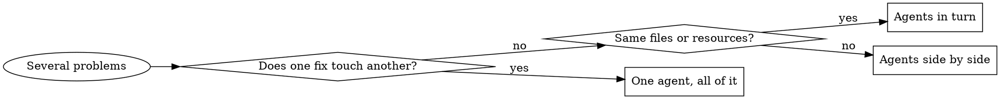

# Dispatching Parallel Agents

Split independent work across subagents so it runs at the same time. One agent takes one problem area. You keep your own context free for coordinating.

Never pass your session's context or history to a subagent. Give it only what its brief holds, and decide exactly what each one needs. This keeps each agent on its task.

The case that comes up most: several things are broken in unrelated places (different test files, different modules, different bugs). Chasing them one after another wastes time, because none of them needs the others.

## When to split



Split when:
- Three or more test files fail, each for its own reason.
- Several modules are broken independently.
- You can explain each problem without mentioning the others.
- The investigations touch no common state.

Keep it in one hand when:
- The failures look related, so one fix may clear several. Look at them together first.
- You need a picture of the whole system to understand any of them.
- You do not yet know what is broken. Explore first, split later.
- Agents could interfere with each other in any way: one agent's output would change another's input, or the result depends on the order they finish. Typical cases are editing the same files or using the same resource (a port, a database, a build folder). Run those one at a time.

## Steps

### 1. Sort the problems into areas

Group by what is broken, not by who noticed it. Test the grouping: a fix in one area must not change the outcome in another.

### 2. Give each area one task

Every task states four things:
- **Scope.** One file or one module.
- **Goal.** The observable result, such as "these tests pass".
- **Limits.** What the agent must leave alone. Default: unless the brief says otherwise, the agent changes nothing outside its scope.
- **Return format.** What it reports back.

### 3. Dispatch together

Put every dispatch call in a single response. Calls issued in the same response run concurrently. Calls spread over several responses run one after another.

```text
Subagent (general-purpose): "Fix invoice-export.test.ts failures"
Subagent (general-purpose): "Fix csv-import.test.ts failures"
Subagent (general-purpose): "Fix session-expiry.test.ts failures"
# All three start at once.
```

### 4. Collect and combine

When the agents report:
1. Read each summary.
2. Check that no two agents changed the same code.
3. Run the whole test suite.
4. Merge the changes.

## Write each brief

A brief must be:
1. **Focused.** One problem area only.
2. **Self-contained.** Include the error text, test names and file paths. The agent cannot ask you.
3. **Explicit about output.** Say what to send back.

Template, filled in with a made-up case:

```markdown
Fix the 2 failing tests in src/billing/csv-import.test.ts:

1. "skips blank trailing rows" - expects 41 records, receives 42
2. "keeps quoted commas in the memo column" - memo is cut at the first comma

Both started after the parser was moved to a streaming reader. This looks like a chunk-boundary and state-handling problem, not a data problem. Your task:

1. Read the test file and note what each test checks.
2. Decide whether the parser is wrong or the test assumes the old behaviour.
3. Fix it:
   - Handle end-of-stream correctly in the reader
   - Respect quote state across chunk boundaries
   - Change a test only if its expectation is outdated, and say why

Do NOT touch src/billing/export/ or any file outside src/billing/.
Do NOT just add retries or longer waits to make a test pass. Find the real cause.

Return: the root cause of each failure and the list of files you changed.
```

## Common mistakes

| Weak brief | Better brief |
|---|---|
| "Fix all the tests": the agent wanders | "Fix csv-import.test.ts": one clear scope |
| "Fix the flaky bug": no starting point | Paste the failing assertions and test names |
| No limits: the agent refactors half the tree | "Tests only" or "Do not change src/billing/export/" |
| "Sort it out": you cannot tell what changed | "Return the root cause and the files changed" |

## Worked example

**Situation.** A dependency upgrade leaves five failures in three test files.

| File | Failures | Symptom |
|---|---|---|
| invoice-export.test.ts | 2 | PDF totals off by one cent |
| csv-import.test.ts | 2 | quoted commas split a field |
| session-expiry.test.ts | 1 | token still valid after the timeout |

**Decision.** Rounding, parsing and session logic share no code, so these are three areas.

**Dispatch.** Three agents in one response, one file each.

**Reports.**
- Export agent: the new library rounds half to even; set the rounding mode explicitly.
- Import agent: quote state was reset at each chunk; carry it across chunks.
- Session agent: the test used real time; switch it to a fake clock.

**Combine.** No overlapping edits, and the whole suite passes.

## After they return

1. **Read every summary.** Know what each agent changed and why.
2. **Look for overlap.** Did two agents touch the same code?
3. **Run the whole suite.** Separate fixes can still clash when combined.
4. **Spot check.** Agents can repeat the same mistake across a task, such as silencing a test instead of fixing the cause.
