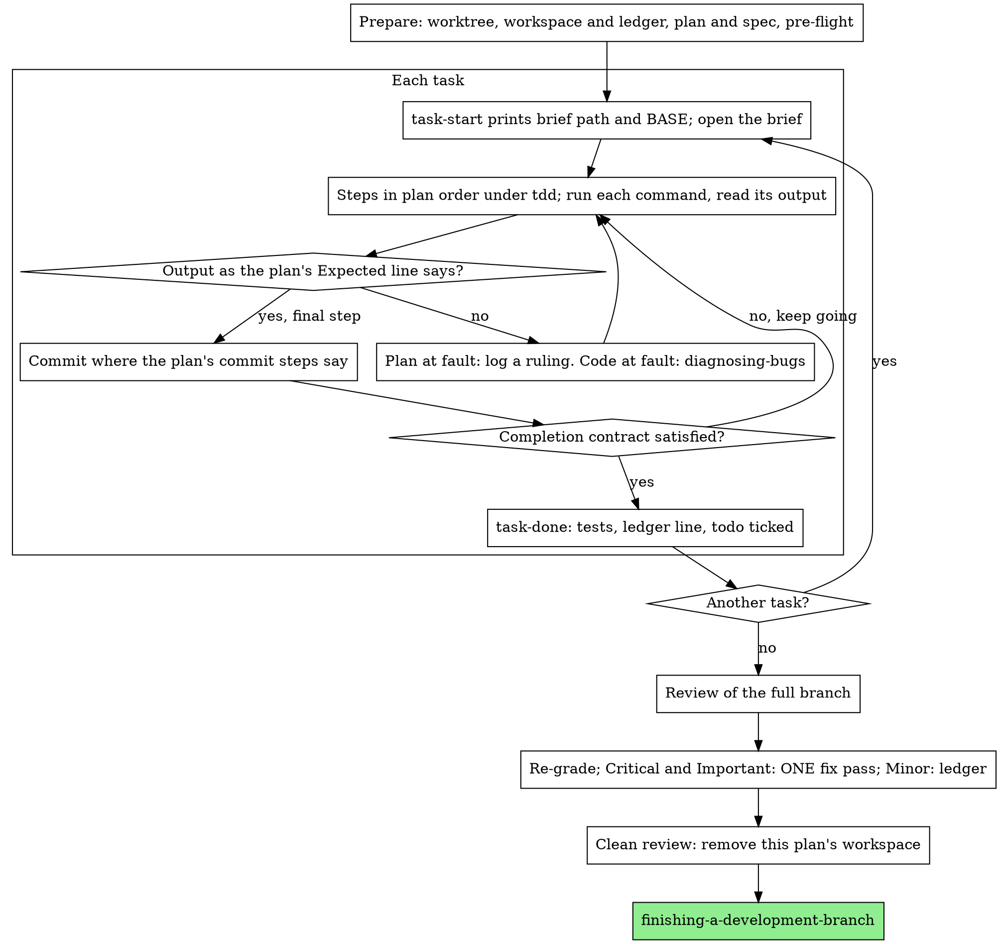

# Executing Plans

You are the builder here. Take the plan and carry it out task by task inside
this session. No subagent builds a task and none checks one. When the last
task is in, one fresh reviewer reads the entire branch.

## What you trade away, and how you get it back

A subagent per task hands you an untouched context and an extra reader for
every task, and you pay for both each time. Running inline costs one context,
yours, plus a single reviewer at the end. What disappears is that untouched
context and that extra reader. Four habits stand in for them:

- The brief is your spec for the task in hand.
- The ledger remembers for you.
- TDD gates every task.
- The final reviewer is the outside reader.

The plan did the thinking already. Execute it as written, see every test go
red and then green, and keep a written trail that survives you forgetting.

## Conduct

**Narrate little.** Between tool calls, one short line is the ceiling. The
ledger and tool output carry the story.

**Keep moving.** Your human partner went inline to spend less and does not
want a "continue?" prompt after each task. Do not pause to check in. Run the
plan through to its last task.

**Decide, do not stall.** Conflicts, ambiguities and plan defects are yours
to settle. The spec outranks everything; the plan is the spec's argument;
where neither speaks, use judgment. Log every decision in the ledger as a
Ruling line (see "Ledger line formats" below) and continue. If you leave the
plan without such a line, you have decided in secret.

**Only these four halt you.** Stop and ask for:

1. any irreversible or destructive operation;
2. any security-sensitive action;
3. any effect beyond this worktree that normal practice says to clear first
   (merging, pushing to a branch others share, publishing);
4. a plan so broken that each way ahead is guesswork.

## Ledger line formats

Every line you append to `progress.md` uses one of these shapes. Text in
angle brackets is yours to fill.

| When | Line |
|------|------|
| Any decision not tied to a task, including pre-flight conflicts (put it beside the row) | `Ruling: <what you decided> — <why> — <what it costs if wrong>` |
| A plan fault found inside a task | `Task <N>: Ruling: <finding> — <what you decided and why>` |
| A task finished (written by `task-done`) | `Task <N>: complete (commits <base7>..<head7>, tests: <command> → <result>)` |
| Nothing shared between tasks | `Pre-flight: no shared interfaces` |
| Reviewer set something aside | `Final: Ruling: <behavior the reviewer set aside> — <what a reasonable person using this software gets, and why that stands or why it is now a finding> — <cost if wrong>` |
| Finding left unfixed | `Final: Ruling: <finding> — <why the code stands> — <cost if wrong>` |
| Minor finding postponed | `Final: minor (deferred): <one-liner>` |
| Critical or Important finding fixed | `Final: fixed <finding> — <test name> RED→GREEN, suite <N>/<N>` |
| Review done by you alone | `Final review: self-review (no subagent tool)` |

## Choosing this skill

- Writing-plans produced the plan and your partner picked inline work at its
  "Execution Handoff" (the "Native" choice).
- The harness offers no way to spawn a subagent (the harness notes are in
  `../using-agent-skills/references/claude-code-tools.md`). Never pretend to
  dispatch. Run the plan yourself.
- The tasks are largely independent, the same condition
  subagent-driven-development needs.

When the plan is fully specified, the work is mostly copying and testing. The
fresh context you get is the final review, which you dispatch on its own.

Prefer subagent-driven-development when your partner wants a review before each
task is accepted, or when the plan is so long that its tail would run on a
badly compacted context. Long plans can run inline, since the ledger lets
you recover, but the closing tasks get the weakest version of you.

## Overview

## Preparation

### Isolation

Start in an isolated worktree, created or confirmed through
using-git-worktrees. Never start building on main or master without your
human partner's explicit consent.

### The ledger

Compaction will eventually erase what you remember. An executor that loses
its place rebuilds tasks that are already committed, and that wastes your
context exactly as a double dispatch wastes a controller's. Record progress
in a file. Todos only mirror the present; the ledger is what lasts.

Both execution skills share one workspace and ledger layout. Hand a plan from
one to the other mid-run and the newcomer continues from the same file.

- Ask for the plan's workspace with
  `../subagent-driven-development/scripts/sdd-workspace PLAN_FILE`. The
  directory it prints sits under `<repo-root>/.studio-work/sdd/<plan-basename>/`,
  is ignored by git, and holds every artifact of this plan: ledger, briefs,
  review packages. Never open or change a directory that belongs to another plan.
- The ledger file is `<workspace>/progress.md`. When its first line names
  your plan, each `Task <N>: complete` entry marks finished work: skip it and
  pick up at the first task lacking one. After a compaction, `git log` and
  the ledger outrank your recollection. A first line naming some other plan
  file means the ledger is someone else's: leave it alone and begin your own.
- A fresh ledger opens with `# SDD ledger — plan: <plan file path>`.
- Warning: `git clean -fdx` deletes the workspace, because git ignores it.
  After that, rebuild your position from `git log`.

### Reading in

Go through the plan a single time. Absorb its context and Global Constraints,
then create one todo per task. When the plan cites a Spec, read it: it is the
authority, and contradictions within the plan resolve in its favour. With no
spec in reach, log that fact; every ruling made blind is provisional.

**REQUIRED SUB-SKILL:** open tdd ahead of Task 1. It rules every step of
every task, even for plans that already tell you to start with a failing
test.

### Pre-flight

Before Task 1, hunt for clashes between tasks, guided by the plan's
Interfaces blocks. Each task that uses output from an earlier task gets one
ledger row naming both tasks, what the earlier one makes versus what the
later one takes, and what you found. Tasks with nothing in common get no row.
If the whole plan has no shared interface, the entire pre-flight is the
single line `Pre-flight: no shared interfaces`. Resolve each clash against the spec,
log the ruling beside the row, then begin. Checking a task's own text waits
until you open its brief.

## Task loop

Output you print and results tools return remain in your context for the
whole session. Send long test output to a workspace file and read only its
last lines. Open a task's brief, not the full plan.

### 1. Open

- Call `scripts/task-start PLAN_FILE N` from this skill. A single call gives
  the brief path, and BASE, where this task's review range begins.
- Read that brief each time, even if the task feels familiar from
  preparation. What you recall is a gist; the brief carries precise values,
  signatures and test cases.
- Set the task's todo to in_progress.

Every tool call forces a re-read of everything you hold. Attach bookkeeping
to productive calls: the ledger append belongs in the commit call, not in a
call by itself.

### 2. Work

The plan's steps already run RED before GREEN, so keep to their order, with
tdd loaded. When a step is a test, write it and run it before anything else.
Watching it fail is part of the work. A test that passes with no code behind
it is a defect in the test.

A step that runs a command also has an `Expected:` line. Run it, read what
it printed, compare. Then one of three things is true:

- **They agree.** Take the next step.
- **Your code is wrong.** Reach for diagnosing-bugs and find the cause. Do not
  bend the code around the symptom to force agreement.
- **The plan is wrong.** The step may clash with the spec, an interface from
  an earlier task may not line up with what this one uses, or a command may
  be unrunnable. Choose the least change that honours the spec, log it as a
  task-level Ruling line, and go on. The ruling is carried by the ledger:
  a later task that touches that interface reads it there, not from memory.

Make your commits where the plan's commit steps place them. A task with
several commits is normal. The review range always starts at BASE; never use
`HEAD~1` for it.

### 3. Completion contract

The task's ledger line waits until all of these hold, shown by something that
happened in this session and not by a diff that looks plausible:

- Each test the brief lists exists, was run during this task, and you read
  what it printed.
- The task's final test run succeeded. That run is `task-done`, which copies
  the command and its outcome into the ledger line.
- Each `Expected:` line in the brief met a real output.
- Each departure from the brief is covered by a `Ruling:` entry.

**REQUIRED SUB-SKILL:** verification-before-completion governs the claim
that the task is done. If any item above is missing, the task is open; finish
it.

### 4. Close

Call `scripts/task-done PLAN_FILE N BASE -- <test command>`, passing the
whole-task test command from the brief. The script runs that command and
stores the complete output in the workspace. It prints the last lines, and
writes the `Task <N>: complete` line only if the tests passed. A failing run
writes nothing, so the task stays open. After a line is written, tick the
todo and take the next task.

## Review of the branch

Build the package with
`../subagent-driven-development/scripts/review-package PLAN_FILE MERGE_BASE HEAD`,
taking MERGE_BASE as the commit where the branch began (`git merge-base main
HEAD` finds it). Read the file it prints.

**Subagent tool present.** Dispatch the `linus-reviewer` agent and leave the
model out, so it uses the model of your own session
(`.claude/agents/AGENTS.md`). Hand it:

- the reviewer prompt file `../requesting-code-review/code-reviewer.md`,
  from the requesting-code-review skill, as its instructions;
- the package path plus the plan and spec paths;
- the plan's Review Focus section exactly as written, when there is one: the
  input classes and failure modes that the plan's own tests leave
  unexercised, each of which the reviewer must probe deliberately;
- the location of the ledger's `Ruling:` lines, so your calls can be weighed.

That reviewer is the one fresh context you buy. Do not omit it, and do not
let your own pass over the diff replace it.

**No subagent tool.** Open code-reviewer.md and perform the review it
describes, against the package, working through it as a pass of its own once
the final task is ledgered. Write `Final review: self-review (no subagent tool)`
in the ledger and say so in your closing message. An author reviewing their
own work is weaker than a fresh reader; your human partner judges whether
that suffices before merging.

### Triage

Sort first, act second. Severity labels from the reviewer are suggestions;
the call is yours.

Every entry on the reviewer's "Set aside" list also becomes a ruling by you,
logged like a plan conflict, with the "Reviewer set something aside" line.

Re-grade by effect. The spec describes a vision. What a finding is worth is
what an ordinary user receives if it ships, and has nothing to do with
whether the spec names the triggering input. If the reviewer marked
something Minor only because the spec said nothing, the spec was graded and
the effect was not. After regrading:

- **Critical** and **Important** findings go to the fix pass.
- **Minor** gets a `minor (deferred)` line and is repeated under "Deferred minors" in your closing message. Minors never join
  the fix pass and never count as rulings; a ruling resolves a conflict and
  is no place to note that you passed on a nicety.

### Fix pass

You, the builder, fix the Critical and Important items, all in ONE pass.
Tests verify each fix, not another reviewer: write a test that reproduces the
finding, watch it fail, turn it green, then run the full suite. Log each fix
with the `Final: fixed` line.

A fix whose test never failed is unproven. Any red in the suite means
the pass is not over. Do not request another review: the new tests show each
finding is addressed, and the suite run shows nothing else broke.

A finding you decline to fix is itself a ruling ("Finding left unfixed").
It reaches your partner through the rulings list. No second fix pass exists.

## Wrap-up

Delete nothing yet. First pull out every ledger line that has `Ruling:` and
list them in your closing message as "Rulings I made", in order, each with its
cost if wrong. List every `minor (deferred)` line as "Deferred minors". Both
lists must be exhaustive, because that message is the sole route by which
your partner learns what you decided for them and what you left unfixed.

With the review clean and its fixes committed, remove this plan's workspace
directory; git history is the archive. Never touch the sibling directories,
which belong to other plans.

Finish with finishing-a-development-branch.

## Excuses that fail

| Thought | Reality |
|---------|---------|
| "I remember what Task N says." | What you hold is a gist. The exact values are in the brief. Open it. |
| "The plan's test code looks right, no need to see it fail." | A test never seen red shows nothing, and the run is cheap. Do it. |
| "One full suite run at the end is enough, not one per step." | Per-step runs show which step caused a break. The end run is the contract, never a replacement. |
| "The plan has this wrong, so I'll simply do what's correct." | Fine, then log the ruling. A deviation with no entry is a hidden decision. |
| "I'll batch the ledger entries every few tasks." | Compaction picks its own moment. Each task gets a line, written in the call that commits. |
| "Maybe I should check in before the next task." | Inline was picked to cut cost, and check-ins burn your partner's time. Only the four stops halt you. |
| "I went through my diff carefully, so the final reviewer adds nothing." | You share your own blind spots. Only the reviewer brings fresh eyes. |
| "The change was trivial, so the tests should pass." | "Should" proves nothing. The contract needs the command and what it printed. |
| "Subagents cost too much, so I'll drop the final review as well." | Reviews per task are already gone. A single review of the entire branch is the minimum. |
| "The reviewer called it Minor, so it is Minor." | That label may only echo the spec's silence. Grade what the user would get. |
| "The fix is obvious, a failing test first is overkill." | Only a test that failed and now passes proves the finding existed and is gone. Otherwise you have a diff and hope. |
| "While I'm in here I may as well fix the minors." | Every one means a new test, a fix and a suite run nobody asked for. Ledger them for your partner. |
