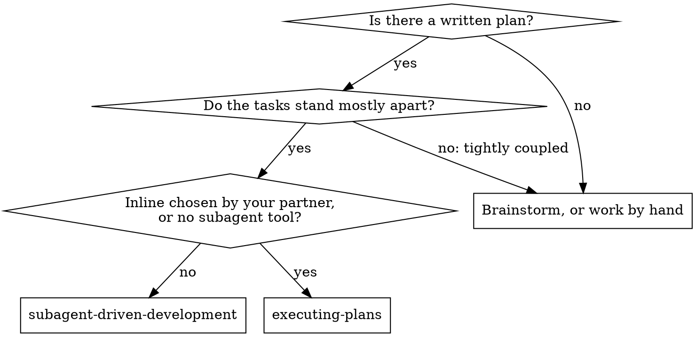
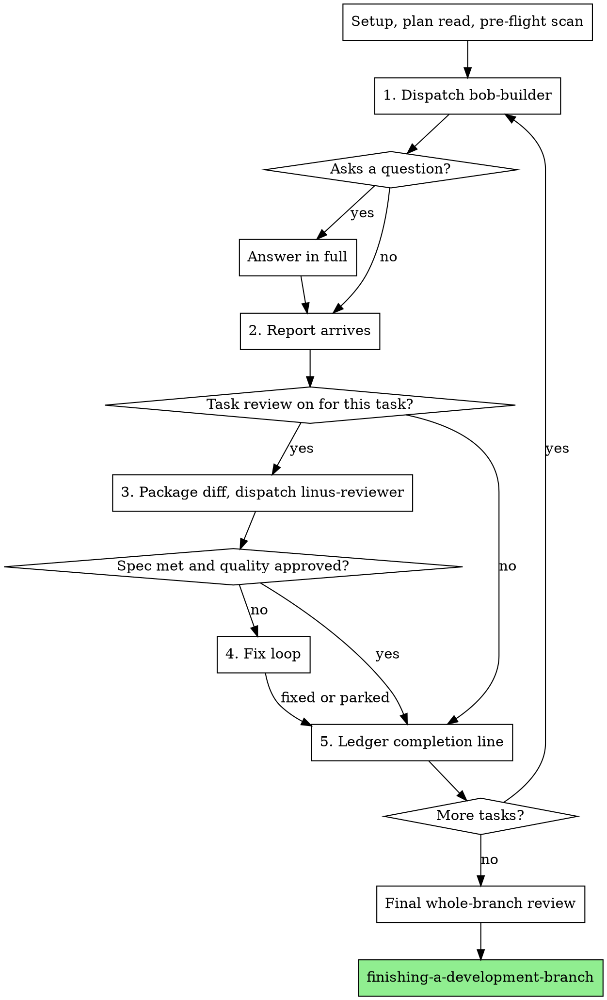

# Subagent-Driven Development

You are the controller. Each plan task goes to its own new `bob-builder` subagent. When the last task lands, one `linus-reviewer` reads the whole branch. Reviewing a task straight after it lands is opt-in. Turn it on for tasks that are risky or under-specified, and for every task if your human partner says so.

Studio default (a studio note on review restraint): on well-specified work, build all tasks first and review the branch once. A reviewer per routine task runs the same loop over and over, and the output is noise. Save task reviews for tasks where one mistake would spread into later work.

Why delegate: a subagent starts with an isolated context that you assemble yourself. It gets exactly what its task needs, and it must never inherit your session's history, so it stays on target. Your own context stays free for coordination.

In one line: new subagent per task, one broad review at the end, a task review only where earned.

## Conduct while the plan runs

- **Say little.** Write one short line at most between tool calls. The ledger and tool results are the record.
- **Do not pause between tasks.** Never ask your human partner whether to go on, and never post progress summaries. The request was to carry out the plan, which means all of it. Only the four stops below, or the last task, end the run.
- **Settle things yourself.** A running plan never waits for a person. Conflicts, ambiguities, plan defects, and a cap you would like to raise are all yours to decide. The spec decides first. The plan is the spec's argument. Your own judgment covers whatever neither one settles. Log each decision as a `Ruling:` line (format below), then continue. A wrong ruling costs rework that your partner can see and reverse. A stalled session costs them a full day and gets them nothing.
- **Four stops, and no others:** (1) an irreversible or destructive operation; (2) a security-sensitive action; (3) an effect beyond this worktree that custom says to clear first, such as merging, pushing to a shared branch or publishing; (4) a plan broken so badly that each next step would be guesswork. On these, halt and ask.

## Ledger lines

The ledger lives in the plan workspace. These are the exact formats.

```
# SDD ledger — plan: <plan file path>                      (always line 1)
Ruling: <what you decided> — <why> — <what it costs if wrong>
Task reviews: <task numbers and why>                       (or: Task reviews: none)
Task <N>: complete (commits <base7>..<head7>, no task review)
Task <N>: complete (commits <base7>..<head7>, review clean)
Task <N>: complete (commits <base7>..<head7>, <K> parked)
Task <N>: minor (deferred): <one-liner>
Task <N>: fix round <R>/5 (<X> addressed, <Y> open — <finding one-liners>; commits <a7>..<b7>)
Task <N>: parked — <finding> — Ruling: <why the code stands>
Task <N>: Ruling: <finding> — <what you decided and why>
```

## Pick the right skill



Against inline execution (executing-plans):
- Each task starts in a clean context, so nothing accumulates. Inline execution stays in one context throughout.
- A risky task can get its own spec-and-quality review. All other work gets a single review at the end, as it does inline.
- Price: an extra context for every task and for every task review. Inline pays for one context plus the final reviewer.
- The two share this session, the workspace and the ledger format, and neither pauses between tasks.
## Overview of the flow



## Setup

1. Start from an isolated worktree: build one with `using-git-worktrees`, or check that the current one qualifies. Do not begin on main or master unless your human partner has said yes to it outright.
2. Keep a ledger. Chat memory is lost at compaction. More than one controller has lost track mid-run and sent out tasks that were already finished, the costliest failure on record. Todos alone do not protect you.
3. Locate this plan's workspace by running, inside this skill's folder:

```
bash scripts/sdd-workspace PLAN_FILE
```

It prints a git-ignored folder under `<repo-root>/.studio-work/sdd/`. Ledger, briefs, reports and review packages for this plan all live there. Leave other plans' folders untouched.

4. The ledger file is `<workspace>/progress.md`. When it is already there, open the [resume notes](references/resuming.md) before doing anything else. They tell you whether the ledger is yours and where to pick up.
5. For a new ledger, line 1 is the identity line (see Ledger lines).
6. After compaction, the ledger and `git log` outrank your recall: the commits the ledger lists exist whether or not you remember making them. If `git clean -fdx` wiped the workspace (it is only scratch), rebuild from `git log`.
7. Go through the plan one time. Jot down its background and its Global Constraints, and create a todo for each task. If the plan points to a Spec, read it as well. The plan argues from the spec, so clashes within the plan are decided against the spec. When no spec can be reached, record that in the ledger: any ruling you issue then is only provisional.
8. Before Task 1, open the [pre-flight notes](references/preflight.md) and carry out the scan they describe. The table and the rulings go in the ledger, along with one `Task reviews:` line that names the tasks getting a review and gives the reason. A task qualifies if it touches security, risks data loss, involves concurrency, defines an interface later tasks build on, or has text too vague to trust. If none qualifies, write `Task reviews: none`. If your human partner asks for reviews, list every task.

## Model Selection

Never set a model on a dispatch. Under the studio's agent rules (`.claude/agents/AGENTS.md`), a subagent uses the model of the session that started it. Do not choose a cheaper tier to save money. A different model is allowed only if your partner assigns one to a particular agent. `bob-builder` is the implementer and `linus-reviewer` is every reviewer; pass the name as `subagent_type`.

## The Task Loop

Plans that repeat one small edit across many files: see the [batching note](references/batching.md) before dispatching.

Whatever you paste into a prompt, and whatever a subagent prints back, is re-read by you on each later turn. Pass bulk material as files.

While subagents work, never poll a wait call with a short timeout, and never block in one open-ended silent wait. Do the local work first: ledger edits, the next package, reading reports. Results come in unprompted. When you are truly idle, wait in bounded stretches of five to ten minutes where the platform lets you. After each stretch, write one status line, list the children still alive and hunt down any that ended without a report. A long wait loses almost no efficiency this way, and a hung or vanished child shows up in minutes, not when the session closes.

### 1. Brief and dispatch the implementer

First record BASE:

```
git rev-parse HEAD
```

Review packages and fix diffs need it.

Make the brief:

```
bash scripts/task-brief PLAN_FILE N
```

The command copies the whole text of task N into a uniquely named file and prints where it put it. Requirements live only in this file. Never make a subagent read the whole plan file. Numbers, magic strings, signatures and test cases are quoted from the brief alone.

Write the prompt with these six items:
1. One line placing the task within the project.
2. The brief path, with the instruction to open it first: it is the requirements, and its exact values are to be used as written.
3. What earlier tasks settled (interfaces, decisions) that the brief itself cannot know.
4. How you resolved any ambiguity you spotted while reading the brief.
5. The report file's location and what the report must contain.
6. The worktree path and the branch, so bob-builder works there. Left to itself it would make a worktree off origin/main.

Dispatch the `bob-builder` agent without a model.

Name the report file after the brief: `…/task-N-brief.md` becomes `…/task-N-report.md`. The implementer writes its full report to that file and answers with only the status, its commits, a one-line test summary and any concerns.

One prompt, one task. Never carry earlier tasks' summaries into later prompts ("state after Tasks 1-3"). One real prompt grew to 42k characters, almost all of it stale history. What a new subagent needs: its task, the interfaces it touches, the global constraints.

The implementer template bans sub-dispatch. The implementer starts no subagents of any kind, helpers included, and above all no reviewer. You order the review once the report is in, where one is on. Reviewers launched by workers duplicated the review the controller was about to order, so each cost an entire extra review seat per task.

When an earlier task parked a finding near code this task changes, link that ledger entry in the prompt.

Keep the agent identity that the dispatch returns. Fix rounds 1 to 3 resume this very agent.

Never run implementers in parallel; their edits collide.

Prompt template: [the implementer template](implementer-prompt.md)

### 2. Read the report

Each implementer ends with one of four statuses.

**DONE.** Check your `Task reviews:` line. If the task is listed, make the package and dispatch the reviewer with the path the command prints:

```
bash scripts/review-package PLAN_FILE BASE HEAD
```

BASE is the commit recorded before this task's dispatch. `HEAD~1` would quietly lose every commit but the last when a task made several. If the task is not listed, read the test evidence in the report and jump to step 5.

**DONE_WITH_CONCERNS, NEEDS_CONTEXT, BLOCKED:** open the [handling notes](references/handling-reports.md) and act on them, every time one of these arrives.

If the implementer has a question, whether before starting or midway, answer it clearly and fully, adding context where useful. Do not hurry it into coding.

### 3. Review one task (only where turned on)

A task review is a gate on a single task, and only tasks named at pre-flight pass through it. The wide review is a separate event: it happens once at the end of every plan. For a task on the list, never skip its review, and refuse any reviewer output that lacks either verdict. Spec compliance and quality are both required. The implementer's self-review never replaces it; you need both. Dispatch `linus-reviewer` without a model.

- **The diff goes in a file.** Build it as in step 2 and hand over the path that was printed. With no bash, collect the commit list, the stat summary and the full diff with ten lines of context (`git log --oneline`, `git diff --stat`, `git diff -U10`) for the range into one uniquely named file. The diff then never enters your context, and the reviewer reads everything in a single call. Use the BASE you recorded. A reviewer is never dispatched without a diff file.
- **Inputs:** three paths (brief, report file, review package) plus the global constraints that bind the task.
- **The constraints block steers attention.** Copy requirements exactly as written from the Global Constraints section of the plan, or from the spec: values, formats, and relations such as "same layout as X" or "matches Y". Process rules (YAGNI, test hygiene, method) already sit in the template. The block holds only what this project's spec demands.
- Open-ended orders such as "check all uses" or "run race tests if useful" need a concrete, task-specific reason, or leave them out.
- Do not request a re-run of tests that the implementer ran on identical code. The report is the evidence.
- **Do not pre-judge findings.** Never tell a reviewer to skip an issue or leave it unflagged. If you expect a false positive, let the reviewer raise it and settle it in the loop. Stop when the prompt you are drafting includes any of these alarm phrases: "do not flag"; "don't treat X as a defect"; "at most Minor"; "the plan chose". That is pre-judging, usually done to skip a loop.

If the reviewer reports "⚠️ Cannot verify from diff" items, open the [unverifiable-items note](references/cannot-verify.md) before completing the task.

Prompt template: [the task-reviewer template](task-reviewer-prompt.md)

### 4. Fix loop

Triggers: spec ❌, any Critical or Important finding, or a ⚠️ item you verified as a real gap. Follow the [fix-loop procedure](references/fix-loop.md), and reopen it before each round even if you read it earlier this session. It fixes the round cap, the breaker and the ledger line of every round, and what you remember of it will not outlast compaction.

### 5. Close the task

Three situations make a task complete: DONE with passing tests while no task review is on; a clean review; or all open findings parked with rulings at the cap. Write the matching completion line (see Ledger lines) together with your other bookkeeping, tick the todo and go on. The next task never starts while the review shows Critical or Important issues that are neither fixed nor parked with a ruling at the cap.

## Final review

With all tasks complete, follow the [final-review procedure](references/final-review.md). It holds the whole-branch review, its one fix wave and the finish.

## Excuses I catch myself making

| What I think | What is true |
|---|---|
| "Close enough on spec compliance" | Spec gaps found by a reviewer mean the task is unfinished. Either fix them, or reach the cap and rule. Nothing else ends it. |
| "I'll fix it myself, dispatching is overhead" | A fix made in the controller fills your context and never gets reviewed. Go back to the implementer. |
| "One more round will converge" | Beyond the cap further rounds stall, because the fault is structural. Rule on it and route it. |
| "The reviewer will just find something new anyway" | The re-review is scoped to the fixes and cannot roam. A new finding in untouched code goes in the ledger, away from the fix cycle. |
| "This finding is obviously wrong, I'll drop it" | You rule only at the cap, and every ruling is written to the ledger. Quiet discards are forbidden. |
| "The fix was small, skip the re-review" | Regressions arrive through fixes nobody reviewed. A scoped re-review closes every round. |
| "Reviews slow the loop down" (said of a task marked for review) | Once a review is on, running the loop without it is unchecked churn. Reviews steer and brake the loop. |
| "Every task should get its own reviewer, to be safe" | The default is no. Repeated reviews of routine tasks read as noise, and the end review covers the branch. Pick the risky tasks during the scan, or let your partner ask for all. |
| "Ledger bookkeeping is overhead" | Only the ledger survives compaction. Without one, controllers have dispatched whole runs of finished tasks again. |
| "The implementer spawned its own reviewer — free extra assurance" | It is a second seat on the same diff, and the gate is your review. A reviewer spawned by a worker is a defect to report, not rigor. |
